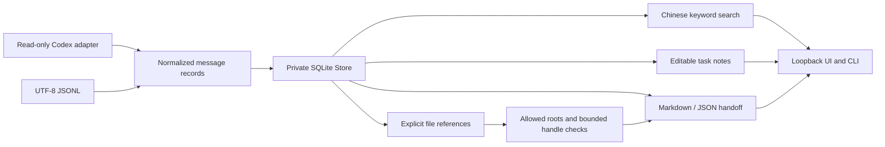

# Architecture

`store.py` owns transactional persistence, immutable imported messages and editable task state. `codex.py` checks the two known source schemas before importing; `importers.py` supplies portable JSONL input. Neither adapter executes embedded instructions.

`files.py` applies syntax, resolved-target and opened-handle checks. Canonical roots are registered explicitly, hashes are bounded, regular-file checks are repeated on the opened descriptor, and permitted documents are downloaded as attachments. `artifacts.py` maintains source references and user confirmation snapshots. Saved check results are timestamped snapshots; GET detail does not refresh them or mutate state.

`handoff.py` combines manual notes, check results and bounded source excerpts. Source text and identifiers are inert fenced blocks in Markdown; JSON contains the private source records. Text changes in the preview are exported without rewriting stored source or notes.

`server.py` binds to IPv4 loopback. Each process generates a fresh bearer token carried to the UI in the URL fragment, then removed from the address bar and retained in same-origin session storage. API requests require the bearer token and strict Host/Origin validation. The UI uses local assets and text nodes, not HTML insertion of messages.

The index schema has a checked version. Connections are short-lived and explicitly closed; imports are atomic. SQLite's backup API captures an index snapshot. No background watchers, cloud synchronization, external embeddings, telemetry or automatic agent orchestration are included.
